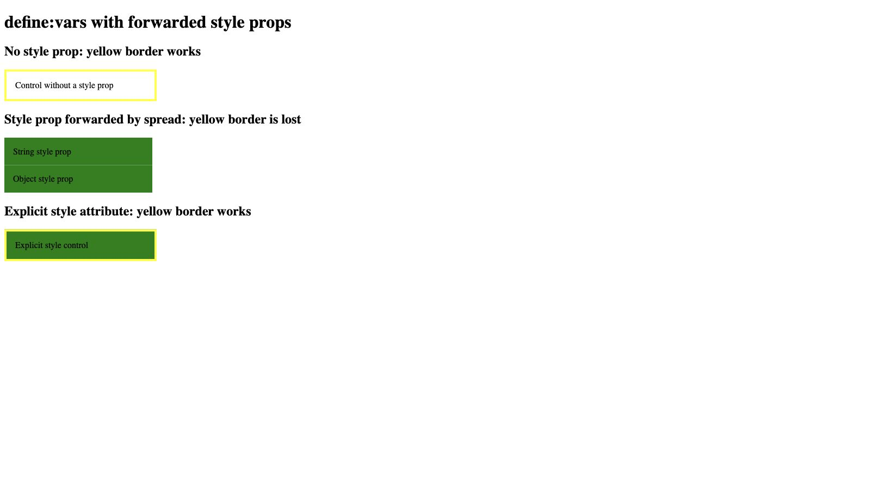

# `define:vars` is lost when a component forwards a style prop

Astro 7.4.2 with `@astrojs/compiler-rs@0.5.2` emits two `style` attributes when a component combines `define:vars` with a spread containing `style`. The browser keeps the first attribute, so the generated CSS variables disappear.

The repro uses the default Astro configuration and normal component props. A caller passing a string or object `style` prop makes the component's yellow border disappear.

## Run

Using Node 24.8.0 and npm 11.6.0:

```sh
git clone https://github.com/jp-knj/astro-define-vars-spread-style-repro.git
cd astro-define-vars-spread-style-repro
npm ci
npm run repro
```

`astro build` succeeds. The subsequent output check exits with status **1** on the affected version, detecting the duplicate attributes and verifying that the controls work. A fixed implementation should pass all four cases.

To inspect the page:

```sh
npm exec astro preview
```

The dependency, override, and lockfile pin compiler-rs to 0.5.2 throughout Astro's dependency tree.

## Component pattern

```astro
---
const { id, ...props } = Astro.props;
const colour = 'yellow';
---
<div id={id} class="box" {...props}><slot /></div>
<style define:vars={{ colour }}>
  .box { border: 4px solid var(--colour); }
</style>
```

A caller passes `<SpreadBox style="background-color: green" />` or `<SpreadBox style={{ backgroundColor: 'green' }} />`.

Expected: the background is green and the border remains yellow. Actual: the background is green, but the border disappears.

The generated element has independent attributes:

```html
<div style="background-color: green" style="--colour: yellow;">
```

The expected result is one merged style, as Astro already generates for an explicit `style={style}` attribute:

```html
<div style="background-color: green; --colour: yellow;">
```

## Browser results

Verified in Brave (Chromium) against the built page:

| Case | Computed `--colour` | Computed border width |
| --- | --- | --- |
| No incoming style prop | `yellow` | `4px` |
| Spread containing a string style | empty | `0px` |
| Spread containing an object style | empty | `0px` |
| Explicit string style attribute | `yellow` | `4px` |



[Browser observations](./browser-observation.json) and [build output](./build-results.txt) record the checks.

## Workaround and scope

`ExplicitBox.astro` demonstrates a workaround: destructure `style` from the component props, forward it through `style={style}`, then spread the remaining props. This requires changing the receiving component's attribute forwarding. Removing the caller's style prop also removes the failure, along with the requested customization.

The demonstrated impact is styling that depends on `define:vars`; this is not a claim that all Astro component styles fail. The tests cover string and object style props, the default configuration, and macOS arm64. The screenshot and JSON record browser behavior, not a native compiler fix.

## Existing report and source

This was reported for the Go compiler in [withastro/compiler #1050](https://github.com/withastro/compiler/issues/1050). It was closed when Go compiler development ended; the maintainer asked for a new Rust-compiler report if it remained reproducible. It remains reproducible with the versions pinned here.

Searches on 2026-10-29 for `define:vars` with spread/style in compiler-rs issues and pull requests did not identify a matching Rust report or active fix. That search does not prove none has ever been filed.

In [compiler-rs main at `5627e84`, `print_html_attributes`](https://github.com/withastro/compiler-rs/blob/5627e84dad90d02809d27c9702aab9351b257781/crates/astro_codegen/src/printer/elements.rs#L577), explicit style attributes use `print_style_with_define_vars`. The spread path emits its attributes independently, and the later fallback appends another style attribute containing `$$definedVars`. That main commit was inspected but not built for this reproduction.

[ISSUE.md](./ISSUE.md) contains a standalone issue draft.
